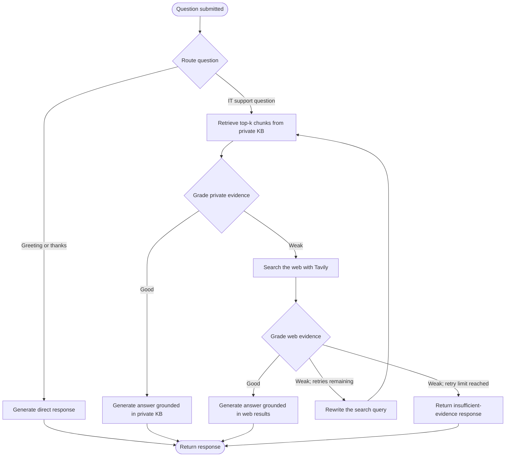
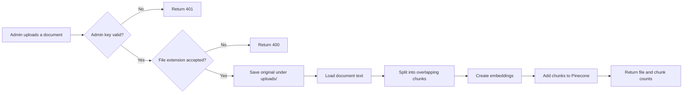

# Enterprise Agentic RAG Support Copilot

An experimental IT-support assistant built with FastAPI, LangGraph, LangChain, Groq, Tavily, Hugging Face embeddings, and Pinecone. It searches a private knowledge base first, grades the retrieved evidence, and can fall back to web search when the private material is not sufficient.

The application includes a browser-based chat UI, a question-answering API, an admin-key-protected document-ingestion endpoint, and a local SQLite audit log.

> **Data-source note:**  The application does not download or ingest that dataset automatically. At runtime, it uses documents supplied to its knowledge base. Confirm the rights and suitability of documents before ingesting or publishing them.

## Contents

- [Features](#features)
- [Workflow diagrams](#workflow-diagrams)
- [Architecture](#architecture)
- [Requirements](#requirements)
- [Configuration](#configuration)
- [Run locally](#run-locally)
- [Add knowledge-base documents](#add-knowledge-base-documents)
- [HTTP API](#http-api)
- [Run with Docker](#run-with-docker)
- [Project layout](#project-layout)
- [Privacy and security](#privacy-and-security)
- [Push to GitHub](#push-to-github)
- [Troubleshooting](#troubleshooting)

## Features

- Routes greetings directly to a language model and IT-support questions through retrieval.
- Retrieves relevant chunks from a Pinecone vector index using a Hugging Face embedding model.
- Grades private-knowledge evidence before generating an answer.
- Uses Tavily web search when private evidence is weak, then grades the web evidence.
- Returns an answer, selected source, citations, rewritten query, and a trace of agent decisions.
- Accepts document uploads through an admin-key-protected endpoint.
- Records chat questions, selected sources, timestamps, and workflow traces in SQLite.
- Serves a browser UI and FastAPI interactive API documentation.

## Workflow diagrams

### Question-answering workflow



The request lifecycle is:

1. The browser posts the question as JSON to `POST /api/chat`.
2. LangGraph asks the Groq chat model to route the request. Greetings and thanks take the direct-response path; IT-support questions proceed to retrieval.
3. The retriever searches the configured Pinecone index and namespace for up to `TOP_K` chunks.
4. The model grades the private evidence. If it is good, the answer is generated from the private knowledge base. If it is weak, the workflow performs a Tavily search.
5. The model grades web results. Good evidence is used to generate a web-grounded response. Weak evidence is intended to trigger query rewriting and another retrieval attempt, or an insufficient-evidence response when the retry limit is reached.
6. The API writes the question, selected source, and trace to SQLite, then returns the answer, citations, and trace.

> **Known retry limitation:** `MAX_RETRIES` is checked, but the current query-rewrite node does not increment `retry_count`. Weak web evidence may therefore cycle through retrieval and web search instead of reaching the configured limit. Do not rely on the retry limit to stop this loop until it is fixed.

### Document-ingestion workflow



## Architecture

| Component | Responsibility |
| --- | --- |
| FastAPI (`app/main.py`, `app/api/routes.py`) | Serves the UI, health check, chat API, and ingestion API. |
| LangGraph (`app/rag/workflow.py`) | Routes questions, retrieves and grades evidence, handles web fallback, and generates answers. |
| Pinecone (`app/rag/vectorstore.py`) | Stores and retrieves embedded document chunks. |
| Hugging Face embeddings | Converts document chunks and queries into vectors; default model is `BAAI/bge-m3`. |
| Groq | Provides the model used for routing, evidence grading, query rewriting, and answer generation. |
| Tavily | Provides external search results when private evidence is weak. |
| Ingestion service (`app/services/ingestion.py`) | Loads supported files and splits them into chunks. |
| SQLite audit service (`app/services/audit.py`) | Stores question text, selected source, timestamp, and trace. |
| Browser UI (`templates/`, `static/`) | Provides chat, citations, workflow trace, and document upload. |

## Requirements

- Python 3.11 (the provided Dockerfile also uses Python 3.11)
- Pinecone account and API key
- Groq API key
- Tavily API key for web fallback
- Network access to the configured providers

The embedding model may download from Hugging Face on first use. The Pinecone index must support 1024-dimensional vectors for the default embedding model.

## Configuration

Create a `.env` file in the project root. `.env` is ignored by Git; never commit real credentials.

```dotenv
APP_NAME=Enterprise IT Support Agentic RAG Copilot
APP_ENV=development

GROQ_API_KEY=replace-with-your-groq-api-key
TAVILY_API_KEY=replace-with-your-tavily-api-key
PINECONE_API_KEY=replace-with-your-pinecone-api-key

PINECONE_INDEX_NAME=fde-it-support-rag
PINECONE_NAMESPACE=company-it-kb
EMBEDDING_MODEL=BAAI/bge-m3
LLM_MODEL=openai/gpt-oss-20b
TOP_K=4
MAX_RETRIES=1

ADMIN_API_KEY=replace-with-a-long-random-secret
```

Settings are loaded from `.env` and can also be supplied as environment variables. Names and defaults below correspond to `app/core/config.py`.

| Variable | Default | Purpose |
| --- | --- | --- |
| `APP_NAME` | `Enterprise IT Support Agentic RAG Copilot` | Application title and health-response service name. |
| `APP_ENV` | `development` | Environment label. |
| `GROQ_API_KEY` | Empty | Required for language-model calls. |
| `TAVILY_API_KEY` | Empty | Required when web search is used. |
| `PINECONE_API_KEY` | Empty | Required to initialize the vector index. |
| `PINECONE_INDEX_NAME` | `fde-it-support-rag` | Pinecone index name. |
| `PINECONE_NAMESPACE` | `company-it-kb` | Pinecone namespace used by the app. |
| `EMBEDDING_MODEL` | `BAAI/bge-m3` | Hugging Face embedding model. |
| `LLM_MODEL` | `openai/gpt-oss-20b` | Model name passed to the Groq integration. |
| `TOP_K` | `4` | Number of chunks retrieved per query. |
| `MAX_RETRIES` | `1` | Intended retry limit; see the known limitation above. |
| `ADMIN_API_KEY` | `change-me` | Required by `POST /api/ingest`; replace before use. |
| `AUDIT_DB_PATH` | `data/audit.db` under the project directory | SQLite audit database location. |
| `UPLOAD_DIR` | `uploads/` under the project directory | Location for uploaded originals. |
| `DATA_DIR` | `data/sample_kb` under the project directory | Folder read by the optional sample-ingestion script. |

If the Pinecone index does not already exist, the helper creates one with 1024 dimensions, cosine metric, and AWS `us-east-1` serverless configuration. Confirm the region, dimensions, and index name against your Pinecone account.

## Run locally

Run these commands from the project root:

```bash
python3.11 -m venv .venv
source .venv/bin/activate
python -m pip install --upgrade pip
python -m pip install -r requirements.txt
```

On Windows PowerShell, activate the environment with:

```powershell
.venv\Scripts\Activate.ps1
```

Create and configure `.env`, then start the development server:

```bash
python run.py
```

The development server binds to `127.0.0.1:8000`. Visit:

- Web UI: <http://127.0.0.1:8000/>
- Health check: <http://127.0.0.1:8000/api/health>
- Interactive API docs: <http://127.0.0.1:8000/docs>

For a deployment-style local command, use:

```bash
uvicorn app.main:app --host 0.0.0.0 --port 8000
```

## Add knowledge-base documents

### Upload through the UI

1. Open the web UI and select **Add Company Document**.
2. Enter the value configured as `ADMIN_API_KEY`.
3. Select a file and choose **Index Document**.
4. The API saves the original under `UPLOAD_DIR`, loads it, splits the text into 200-character chunks with 40-character overlap, embeds the chunks, and adds them to Pinecone.

### Upload through the API

The endpoint requires an `X-Admin-Key` header and a multipart file:

```bash
curl -X POST http://127.0.0.1:8000/api/ingest \
  -H "X-Admin-Key: $ADMIN_API_KEY" \
  -F "file=@./path/to/company-policy.pdf"
```

The loaders implement PDF, TXT, Markdown, and DOCX parsing. **Currently, the API extension check accepts `.pdf`, `.md`, and `.docx`, but rejects `.txt`** because the supported-extension set omits the leading dot for `txt`. The browser advertises `.txt`, so its choices do not exactly match the API.

### Index a folder of sample documents

`ingest_sample_kb.py` reads every file directly inside `DATA_DIR`, loads and chunks the documents, and indexes them in Pinecone. Add only documents that you intend to index:

```bash
mkdir -p data/sample_kb
python ingest_sample_kb.py
```

This script requires `PINECONE_API_KEY` and access to the configured index. Keep confidential knowledge-base files out of source control.

## HTTP API

| Method | Path | Description |
| --- | --- | --- |
| `GET` | `/api/health` | Returns a simple service health response. |
| `POST` | `/api/chat` | Accepts a JSON question and returns an answer, source, trace, citations, and rewritten query. |
| `POST` | `/api/ingest` | Uploads and indexes a document; requires `X-Admin-Key`. |

### Chat request

```http
POST /api/chat
Content-Type: application/json
```

```json
{
  "question": "How do I connect to the company VPN?"
}
```

The question must contain 2–3000 characters. A successful response has this shape:

```json
{
  "answer": "Answer text...",
  "source_used": "private_kb",
  "trace": ["Router -> KB", "private KB retrieval -> 4 chunks"],
  "citations": [
    {
      "title": "vpn-guide.pdf",
      "url": "",
      "type": "private_kb"
    }
  ],
  "rewritten_query": "How do I connect to the company VPN?"
}
```

Values depend on the workflow path. The source may indicate a direct response, private-KB answer, web answer, or insufficient evidence.

### Health response

```json
{
  "status": "ok",
  "service": "Enterprise IT Support Agentic RAG Copilot"
}
```

## Run with Docker

Build and start the container from the project root:

```bash
docker build -t enterprise-agentic-rag .
docker run --rm --env-file .env -p 8080:8080 enterprise-agentic-rag
```

Visit <http://127.0.0.1:8080/>. The Docker image uses Python 3.11 and starts Uvicorn on port 8080 by default.

Review `.dockerignore` before building or publishing an image. Do not include `.env`, private knowledge-base files, audit databases, or uploaded originals in an image intended for distribution.

## Project layout

```text
.
├── app/
│   ├── api/
│   │   └── routes.py            # Health, chat, and ingestion endpoints
│   ├── core/
│   │   ├── config.py            # Environment-backed settings
│   │   └── logging.py           # Logging setup
│   ├── rag/
│   │   ├── state.py             # LangGraph state and structured outputs
│   │   ├── vectorstore.py       # Embeddings and Pinecone access
│   │   └── workflow.py          # Routing, retrieval, grading, answer flow
│   ├── services/
│   │   ├── audit.py             # SQLite query audit
│   │   └── ingestion.py         # Document loading and chunking
│   └── main.py                  # FastAPI app and UI routes
├── data/                        # Local audit data and optional sample KB
├── static/
│   ├── css/style.css
│   └── js/app.js
├── templates/index.html         # Chat and upload interface
├── uploads/                     # Uploaded document originals
├── .dockerignore
├── .gitignore
├── Dockerfile
├── ingest_sample_kb.py          # Index files from DATA_DIR
├── requirements.txt
└── run.py                       # Local development server
```

## Privacy and security

- Never commit `.env`, API keys, admin keys, audit databases, private knowledge-base content, or uploaded originals.
- Replace `ADMIN_API_KEY=change-me` with a strong secret. The ingestion endpoint uses this key; the chat endpoint is not authenticated.
- The audit database stores question text and workflow traces. Treat it as potentially sensitive and protect its filesystem location.
- Uploaded originals are saved on disk and indexed in the configured Pinecone namespace. Deleting a local upload does not by itself remove its vectors from Pinecone.
- Confirm that you are authorized to process documents and send relevant questions or evidence to third-party model, embedding, and search providers.
- `.gitignore` excludes `.env` and `data/`, but this repository already tracks a file under `uploads/`. Ignore rules do not remove tracked files or erase Git history.

## Push to GitHub

> **Review before publishing:** This repository already tracks an uploaded PDF under `uploads/`. It may contain sensitive or personal information; it was not inspected as part of this README change. Confirm that you are authorized to publish it. If it is confidential, remove it from the repository and arrange to remove it from Git history before publishing. Adding an ignore rule alone does not untrack a file or erase earlier commits.

After creating an empty GitHub repository, review files and history for secrets and private data. Run these commands from the project root:

1. Inspect the current branch, working tree, tracked files, and history:

   ```bash
   git status --short --branch
   git ls-files
   git log --oneline --all
   ```

2. Review the results. Do not use `git add .` until you know every included file is suitable for publication.

3. Stage only the files you intend to publish. For just the README:

   ```bash
   git add README.md
   git diff --cached --check
   git diff --cached
   ```

4. Commit the reviewed changes:

   ```bash
   git commit -m "docs: write project README"
   ```

5. If no `origin` remote exists, add your GitHub repository URL. Replace `OWNER` and `REPOSITORY` with your account or organization and repository name. Check an existing remote with `git remote -v` instead of adding a duplicate.

   ```bash
   git remote add origin https://github.com/OWNER/REPOSITORY.git
   ```

6. Push the branch. If your branch is not already named `main`, rename it only if that is appropriate for your repository:

   ```bash
   git branch -M main
   git push -u origin main
   ```

A new commit does not erase sensitive files from earlier commits. If private content entered Git history, treat it as exposed to anyone with access to that history and follow an approved history-cleanup and credential-rotation process before publishing.

## Troubleshooting

| Symptom | Checks |
| --- | --- |
| Chat request fails | Confirm `GROQ_API_KEY` is set and valid; inspect application logs for provider errors. |
| Pinecone initialization fails | Check `PINECONE_API_KEY`, index name, namespace, region, and vector dimension. |
| Web fallback fails | Confirm `TAVILY_API_KEY` is set and valid. |
| Upload returns `401` | Set the request's `X-Admin-Key` header or UI key to the `ADMIN_API_KEY` value. |
| TXT upload returns `400` | The current API extension check rejects `.txt`; see [Add knowledge-base documents](#add-knowledge-base-documents). |
| Dependency installation fails | Use Python 3.11 and install the pinned `requirements.txt` in a fresh virtual environment. |
| First query is slow | The embedding model may need to download before it can create embeddings. |
| Audit database cannot be created | Ensure the parent directory of `AUDIT_DB_PATH` exists and is writable. |
